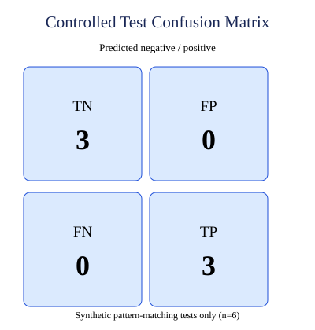

# SentinelSOC

**Windows detection engineering and evidence-based security research using Wazuh, Sysmon and Python**

  

SentinelSOC is an independent cybersecurity research and engineering portfolio project. It investigates custom Windows threat-detection rules through an isolated laboratory, actual event collection, controlled Wazuh tests, and reproducible offline analysis.

> **Evidence boundary:** The failed-authentication custom rule was confirmed during live Windows-to-Wazuh ingestion. The PowerShell rule was verified in an isolated rule-engine test, and a qualifying live Administrators-group detection was not confirmed. This is not an evaluation of production detection accuracy.

## Research question

What evidence can a resource-constrained Windows laboratory provide about custom SIEM detection rules, and how should live alerts, simulated rule-engine tests, and small-scale offline classification results be distinguished?

## Detection validation

| Scenario | Windows event | Custom rule | Supported result |
| --- | --- | --- | --- |
| Failed authentication | Security 4625 | `100101` | **Verified live** |
| Encoded PowerShell execution | Sysmon 1 | `100102` | Simulated Sysmon JSON matched in `wazuh-logtest`; real process captured by Sysmon; **live custom alert not confirmed** |
| Local Administrators-group addition | Security 4732 | `100103` | Offline rule investigation; **qualifying live alert not confirmed** |

The built-in failed-authentication rule `60122` (level 5) and custom rule `100101` (level 9) were observed on **separate** controlled login attempts. The custom rule changes classification and alert severity. This does not establish increased detection sensitivity or fewer false positives.

[Methodology](reports/methodology.md) · [Validation table](reports/detection_validation_status.csv) · [Live detection evidence](reports/live_detection_results.md)

## Laboratory architecture

```text
Windows 10 / VirtualBox
  |
  +-- Windows Server 2019
  |      +-- Sysmon 15.22 (process events)
  |      +-- Windows Security EventChannel
  |      +-- Wazuh agent 4.14.10
  |                  |
  +-- Ubuntu Server 24.04 / Wazuh manager 4.14.10
                     |
             Alerts and event exports
                     |
            Python research workflow
                     |
            Research reports + results
```

The original experiments used authorized, isolated virtual machines. The offline Python evaluation can be reproduced **without** running the VMs.

## Recorded evidence

| Evidence item | Count |
| --- | ---: |
| Exported Sysmon process-creation events | 415 |
| Identified PowerShell events | 19 |
| Security events in JSONL replay | 4 |
| Failed-login events in replay | 1 |
| Group-membership events in replay | 3 |
| Administrators-group additions in replay | 0 |

Six **deliberately constructed** PowerShell classification examples yielded TP=3, TN=3, FP=0, FN=0. Their 100% result applies **only to these six examples** and is not a field accuracy estimate.



[Consolidated findings](reports/consolidated_research_results.md) · [MITRE ATT&CK mapping](reports/mitre_attack_mapping.csv) · [Controlled test cases](datasets/powershell_controlled_tests.csv)

## Repository structure

| Path | Contents |
| --- | --- |
| [`configurations/`](configurations/) | Custom Wazuh rule definitions |
| [`scripts/`](scripts/) | Python evaluation and report generation |
| [`datasets/`](datasets/) | Controlled tests and selected Windows evidence |
| [`reports/`](reports/) | Experimental results, methodology and limitations |
| [`screenshots/`](screenshots/) | 13 selected evidence images |
| [`REPRODUCIBILITY.md`](REPRODUCIBILITY.md) | Offline reproduction instructions |

## Reproduce the analysis

Python 3.10+ is required. The scripts use no third-party packages. Run from the repository's top-level directory:

```text
python scripts/evaluate.py
python scripts/build_research_report.py
python scripts/finalize_research.py
```

These commands reproduce specific **offline** reports from the datasets; they do not repeat live Wazuh tests. See [REPRODUCIBILITY.md](REPRODUCIBILITY.md).

## Evidence highlights

- [Windows Wazuh agent connected](screenshots/08-windows-server-wazuh-agent-connected.PNG)
- [Built-in failed-login alert](screenshots/09-wazuh-baseline-failed-login.PNG)
- [Custom failed-login rule evidence](screenshots/07-wazuh-failed-login-rule-100101.PNG)
- [PowerShell rule-engine evidence](screenshots/05-wazuh-powershell-custom-rule-100102.PNG)
- [Python evaluation output](screenshots/11-python-evaluation-results.PNG)

## Limitations and future research

- **One of three** custom detection scenarios has a confirmed live alert.
- A genuine encoded PowerShell execution appeared in Sysmon, but a corresponding live custom Wazuh alert was not observed.
- Examined Event ID 4732 records concern `Users` and `IIS_IUSRS`, not `Administrators`.
- The deliberately constructed six-example classifier test is insufficient for estimating production accuracy.
- Built-in and custom authentication alerts came from separate login attempts, so a controlled same-event comparison is outstanding.
- Proposed extensions include native live validation of remaining rules, independent ground truth, matched baseline testing, repeated measurements and detection-latency analysis.

**Ethical scope:** All reported experiments took place in an isolated, authorized laboratory. The repository is a research prototype and does not include VM images or a live SOC deployment.
