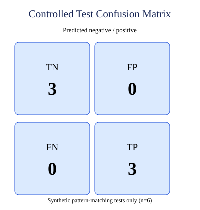

# SentinelSOC — Consolidated Research Results

## Real evidence inventory

| Evidence item | Count |
| --- | ---: |
| Sysmon process-creation events | 415 |
| Identified PowerShell events | 19 |
| Windows Security replay events | 4 |
| Failed-authentication replay records | 1 |
| Group-membership replay records | 3 |
| Administrators-group additions in replay | 0 |

These are descriptive evidence counts, **not** detection performance estimates.

## Six-case controlled pattern evaluation

| Metric | Value |
| --- | ---: |
| Deliberately constructed examples | 6 |
| True positives | 3 |
| True negatives | 3 |
| False positives | 0 |
| False negatives | 0 |
| Precision, recall and F1 on these cases | 1.00 each |

This test is too small and deliberately constructed to represent real-world detection accuracy.

## Verified live failed authentication

| Configuration | Rule | Level | Windows event | Result |
| --- | --- | ---: | --- | --- |
| Built-in baseline | `60122` | 5 | Security 4625 | Live alert observed |
| SentinelSOC custom | `100101` | 9 | Security 4625 | Live alert observed |

The two alerts came from **separate controlled failed-login attempts**. Custom rule `100101` is a child of `60122`; it adds classification and severity, but the experiments do not demonstrate increased detection sensitivity.

[Live detection details](live_detection_results.md) · [Baseline image](../screenshots/09-wazuh-baseline-failed-login.PNG) · [Custom rule image](../screenshots/07-wazuh-failed-login-rule-100101.PNG)

## Offline versus live verification

| Scenario | Offline evidence | Live evidence |
| --- | --- | --- |
| Failed authentication (`100101`) | Earlier replay observation | **Verified** custom live alert |
| Encoded PowerShell (`100102`) | Simulated Sysmon JSON matched rule in `wazuh-logtest` | Real process observed in Sysmon; custom Wazuh live alert **unverified** |
| Administrators-group addition (`100103`) | Available Event ID 4732 evidence and rule test | No qualifying Administrators addition; custom live alert **unverified** |

The observed group records concern `Users` and `IIS_IUSRS`, not Administrators.

## Research limitations

- Six constructed classifier examples are not an independent real-world sample.
- Live baseline and custom alerts were not evaluated under matched event-stream conditions.
- Live PowerShell and Administrators-group custom detections were not confirmed.
- Simplified JSON replay and native Windows agent ingestion are not equivalent.
- No statistically meaningful accuracy, false-positive or latency comparison has been performed.

## Supporting documentation

[Methodology](methodology.md) · [Validation status](detection_validation_status.csv) · [Reproducibility](../REPRODUCIBILITY.md) · [Screenshots](../screenshots/)
